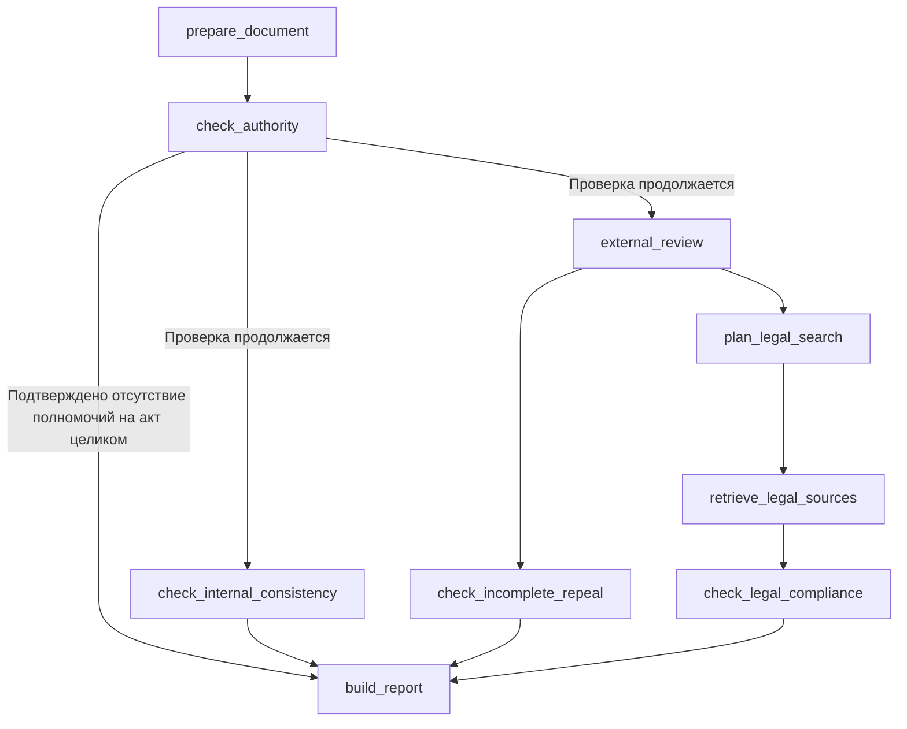

# Antikorr — правовая экспертиза проекта НПА

Навык проверяет проект нормативного правового акта органа власти Ульяновской области
и формирует юридическое заключение: скачиваемый DOCX без дублирования текста в чате. Для каждого
подтверждённого замечания указываются место в проекте, дословная цитата и основание.

На вход подаётся файл проекта и, при необходимости, пояснительная записка.
Навык получает обезличенные документы из платформенного s3-service, ищет правовые
источники в Консультант+ через MCP и выполняет один граф LangGraph.
История чата и постоянное хранение файлов принадлежат платформе; сервис stateless.

**Основной принцип:** отсутствие найденных замечаний не означает, что проект
полностью проверен. Заключение отдельно показывает результат каждого направления,
непрочитанные источники и ограничения экспертизы. LLM предлагает правовые выводы;
код проверяет цитаты и определяет, какие находки можно включить в отчёт.

Стек: Python 3.13+, uv, FastAPI, FastMCP, LangGraph, Pydantic, Dynaconf,
structlog и Prometheus. Собственных БД, Kafka-воркеров и локального OCR нет.

## Содержание

- [Что проверяет навык](#что-проверяет-навык)
- [Быстрый запуск](#быстрый-запуск)
- [Настройки и внешние сервисы](#настройки-и-внешние-сервисы)
- [Вызов из платформы](#вызов-из-платформы)
- [Результат и статусы проверок](#результат-и-статусы-проверок)
- [Как проходит экспертиза](#как-проходит-экспертиза)
- [Модели и промпты](#модели-и-промпты)
- [Структура репозитория](#структура-репозитория)
- [Разработка и проверки](#разработка-и-проверки)
- [Docker и CI/CD](#docker-и-cicd)
- [Наблюдаемость и диагностика](#наблюдаемость-и-диагностика)
- [Границы качества](#границы-качества)
- [Документация](#документация)

## Что проверяет навык

| Направление | Что делает |
| --- | --- |
| Компетенция органа | Устанавливает издателя и форму акта, читает источники полномочий и проверяет право органа принять проект |
| Внутренняя согласованность | Проверяет отсылки, состав приложений, наименование услуги, сроки и несовместимые значения одной величины |
| Соответствие вышестоящим актам | Подбирает и читает правовые источники, сопоставляет с ними положения проекта с учётом предмета, процедуры и границ права |
| Полнота и корректность отмены | Проверяет отменяемые акты, связанные изменения и покрытие цепочки отменой |

Внутренние проверки детерминированы и ограничены перечисленными случаями.
Свободный поиск смысловых противоречий между всеми положениями проекта не выполняется;
это ограничение указывается в заключении.

Поддерживаются **DOCX, PDF и TXT с текстовым слоем**. Проект обязателен:
одна пояснительная записка не запускает экспертизу. Для сканов нужно предварительное
распознавание. Восстановление переносов и разметки уже извлечённого текста не заменяет OCR.

## Быстрый запуск

Нужны Python 3.13+, [uv](https://docs.astral.sh/uv/) и доступ к RouterAI,
s3-service и MCP-серверу Консультант+. Все команды выполняются из корня репозитория.

```bash
make install
cp .env.example .env
```

В `.env` заполните `ROUTER_AI_API_KEY` и `S3_SERVICE_ACCESS_TOKEN`, проверьте
адреса `ROUTER_AI_BASE_URL`, `S3_SERVICE_BASE_URL` и `BASE_MCP_URL`.
При необходимости настройте авторизацию MCP. Затем запустите сервис:

```bash
make run
```

Эквивалент без Make:

```bash
uv sync --frozen
uv run python -m src.app.run
```

Проверка запущенного приложения:

```bash
curl --fail http://127.0.0.1:8080/health
curl --fail http://127.0.0.1:8080/metrics
```

| Адрес по умолчанию | Назначение |
| --- | --- |
| `http://127.0.0.1:8080/mcp/` | MCP-сервер навыка, инструмент `antikorr_invoke` |
| `http://127.0.0.1:8080/health` | Живость приложения |
| `http://127.0.0.1:8080/metrics` | Метрики Prometheus |
| `http://127.0.0.1:8080/docs` | Swagger для HTTP-маршрутов; MCP-инструмент вызывается MCP-клиентом |

По умолчанию приложение слушает `127.0.0.1:8080`. Порт задаётся `PORT`,
затем `API_PORT`; хост — `API_HOST`. Автоперезагрузка включается через
`UVICORN_RELOAD=1`. Node.js и отдельный frontend для запуска не требуются.

## Настройки и внешние сервисы

Dynaconf загружает два файла:

- [antikorr.toml](src/common/config/antikorr.toml) — параметры приложения,
  предметных алгоритмов, S3 и MCP.
- [antikorr_llms.toml](src/common/config/antikorr_llms.toml) — модели,
  параметры генерации, таймауты и повторы.

Секреты и адреса окружения задаются через переменные окружения, корневой `.env`
или собственный Vault-путь `secrets/dynaconf/antikorr`. Локальный пример —
[.env.example](.env.example). В режиме `API_MODE=DEV` Vault отключается.
Не коммитьте `.env` и не используйте секреты оркестратора вместо секретов навыка.

| Переменная | Назначение |
| --- | --- |
| `ROUTER_AI_API_KEY` | Обязательный ключ LLM-провайдера |
| `ROUTER_AI_BASE_URL` | Обязательный адрес OpenAI-совместимого API; локальный default — `https://routerai.ru/api/v1` |
| `S3_SERVICE_BASE_URL` | Обязательный адрес платформенного сервиса документов |
| `S3_SERVICE_ACCESS_TOKEN` | Обязательный токен s3-service |
| `BASE_MCP_URL` | Обязательный базовый адрес правового MCP; путь Консультант+ задан в TOML как `consultant/mcp` |
| `KB_MCP_AUTH_TOKEN` | Токен MCP, если нужен в выбранном окружении |
| `USE_KEYCLOAK`, `KEYCLOAK_*` | Авторизация MCP через Keycloak, если включена |
| `MCP_TIMEOUT_S` | Таймаут MCP-клиента; в примере окружения — 45 секунд |
| `LANGFUSE_BASE_URL`, `LANGFUSE_PUBLIC_KEY`, `LANGFUSE_SECRET_KEY` | Необязательное подключение удалённых шаблонов промптов |
| `LANGFUSE_PROMPT_LABEL` | Метка удалённых шаблонов, по умолчанию `production` |
| `PROMPTS_DIR` | Каталог локальных YAML-промптов |
| `LOGLEVEL`, `LOG_RENDERER` | Уровень логов и формат: `console` или `json` |

Для обязательных адресов могут быть defaults в TOML, но пустые значения недопустимы.
При старте приложение проверяет обязательные настройки и все восемь LLM-ролей,
их параметры, URL и политику повторов до инициализации MCP. Ошибка сообщает имена
недостающих настроек без значений секретов.

### Ограничения ресурсов

| Параметр TOML | Текущее значение | Область действия |
| --- | ---: | --- |
| `app.max_upload_mb` | 100 | Максимальный размер входного документа |
| `app.intake.max_intake_files` | 5 | Максимальное число входных файлов |
| `mcp.max_concurrent_calls` | 10 | Одновременные обращения к одному MCP-серверу в процессе, включая чтение и повторы |
| `agents.competence.max_sources` | 7 | Источники проверки полномочий |
| `agents.legal.max_acts` | 10 | Максимум актов правового отбора |
| `agents.legal.target_acts` | 5 | Целевой объём смыслового отбора источников |
| `agents.legal.review.timeout_s` | 65 с | Временной бюджет этапа сверки, остаток которого ограничивает дедубликацию |

При нескольких процессах или репликах MCP-лимиты складываются. Лимиты чтения,
контекста и времени не дают оснований считать частичную экспертизу полной.

## Вызов из платформы

**Единственный продуктовый вход — MCP `antikorr_invoke` на `/mcp/`.**
Загрузка файлов выполняется платформой. Прежние маршруты `/antikorr/upload`
и `/antikorr/sse/{thread_id}` удалены вместе с временной локальной UI.

Описание навыка доступно как ресурс `skill://antikorr/SKILL.md`;
его исходник — [src/skills/antikorr/SKILL.md](src/skills/antikorr/SKILL.md).

Параметры инструмента передаются в обёртке `data`:

| Поле | Обязательность | Смысл |
| --- | --- | --- |
| `thread_id` | Да | UUID текущего чата; используется как S3 `chat_id` при загрузке заключения |
| `file_ids` | Нет | UUID файлов текущего сообщения: проект и сопроводительные материалы |
| `history_messages` | Нет, default `[]` | История для выбора вложений, если текущие `file_ids` не заданы |
| `message_id` | Нет | UUID ответа; при отсутствии создаётся один UUID для всех пакетов вызова |

Пример аргументов `tools/call` для MCP-клиента. UUID файлов нужно заменить
идентификаторами документов, уже загруженных в s3-service:

```json
{
  "name": "antikorr_invoke",
  "arguments": {
    "data": {
      "thread_id": "b51d3512-c304-426f-bdc6-7ff246890690",
      "file_ids": ["ff4eb6fb-6fa4-481e-90b3-318be6fc625a"],
      "history_messages": []
    }
  }
}
```

Непустой `file_ids` имеет приоритет. Иначе используются вложения последнего
пользовательского сообщения с файлами. Вложения разных сообщений не объединяются;
повторы UUID удаляются с сохранением порядка. Элемент истории содержит `role`
(`user` или `assistant`), `fragments` и `file_ids`. Текст истории не управляет экспертизой.
Точная схема — [app/mcp/schemas.py](src/app/mcp/schemas.py).

Документы скачиваются только через `/s3/download/{file_id}/anonymized`.
Переключения на исходный необезличенный текст нет. Исходный PDF отдельно
для восстановления геометрии не загружается: текстовый артефакт не доказывает
расположение ячеек таблицы, и это ограничение сохраняется в результате.

Для подключения к native-orchestrator нужен стабильный развёрнутый адрес сервиса
и регистрация навыка в платформе. Локальные тесты сами по себе регистрацию в LegalOS
и работоспособность удалённой интеграции не подтверждают.

## Результат и статусы проверок

Во время выполнения инструмент отправляет уведомления MCP: сначала скелет
сообщения, затем короткие `think`-фрагменты прогресса. Последнее уведомление —
единственный терминальный конверт `{"data": Message}`. Его `response`-фрагмент
содержит только `file_id` скачиваемого DOCX; `content` и `answer` пустые.

Сам инструмент возвращает `answer`, `thread_id`, `message_id` и
`finish_reason` (`success` или `error`). Идентификатор ответа одинаков во всех
пакетах; base64 файла пользователю не передаётся.

DOCX формируется из результата одного прогона графа. Генератор создаёт
файл в памяти и загружает его через `POST /s3/upload/{key}` с
`kind=anonymized`, `chat_id=thread_id`. Загрузка считается успешной только
при ответе `status=ok` с UUID файла.

| Статус направления | Что означает |
| --- | --- |
| `completed` | Проверка выполнена в заявленном объёме |
| `limited` | Выполнена частично; причина ограничения включена в заключение |
| `not_checked` | Проверка не выполнена; вывод об отсутствии нарушений не делается |
| `not_applicable` | Направление неприменимо к данному проекту |

`finish_reason=success` означает, что файл заключения создан и загружен, и не обещает
отсутствия нарушений или полноты всех проверок. Все находки и ограничения включены
в DOCX. Если генерация или доставка DOCX не удалась, возвращается `error`
с коротким сообщением и `file_id=null`, без текста заключения. Повторный запрос
запускает новую экспертизу.
Отмена распространяется без успешного терминального события.

## Как проходит экспертиза



Граф собирается в [agents/graph.py](src/agents/graph.py). Отчёт запускается
после завершения начатых ветвей. Других графов и переключателей направлений нет.

1. **Подготовка документа.** Определяются проект и сопроводительные материалы,
   восстанавливается структура текста, извлекаются положения, ссылки и основания.
2. **Компетенция.** Стандартную шапку известного органа код разбирает без LLM,
   если распознаны все номерные ссылки с датами. Другие форматы разбирает
   `competence_parse`; затем читаются источники и вызывается проверка полномочий.
   Сбой разбора даёт `not_checked`, а не отсутствие полномочий. Остальные
   направления продолжаются. Досрочное завершение возможно только при
   подтверждённом отсутствии полномочий на акт целиком.
3. **Внутренние проверки и внешняя экспертиза.** Эти ветви работают параллельно.
   Во внешней ветви детектор отмены выполняется одновременно со всем подграфом
   сверки с вышестоящим правом.
4. **Поиск и чтение источников.** Планирование выделяет вопросы, ссылки и
   предметные запросы. Поиск по реквизитам и предмету идёт параллельно,
   повторяющиеся запросы исключаются. Модель отбирает карточки; выбранные
   акты читаются с проверкой идентичности, редакции и свежих метаданных.
   Найденная карточка ещё не считается прочитанным правовым основанием.
5. **Правовая сверка.** Три независимые операции получают полный проект
   и все доступные выбранные акты. `legal_verdict` проверяет соответствие
   в целом; `legal_scope` — круг лиц, территорию, статус и длительность
   ограничений; `legal_refusal` — дополнительные основания отказа по закрытым
   перечням вышестоящих норм. Код подтверждает цитаты, восстанавливает адреса и исключает
   неподтверждённые выводы. Затем `legal_dedup` группирует смысловые повторы
   готовых замечаний с сохранением исходных цитат. При сбое объединения
   замечания сохраняются, а полнота результата ограничивается.
6. **Заключение.** Находки, дата и статусы направлений включаются в DOCX.
   Итоговый ответ содержит только файл.

## Модели и промпты

Текущие настройки закреплены в [antikorr_llms.toml](src/common/config/antikorr_llms.toml):

| Роль | Задача | Модель | Выходные токены | Таймаут |
| --- | --- | --- | ---: | ---: |
| `competence_parse` | Разбор шапки | GPT-6 Luna, reasoning отключён | 4096 | 60 с |
| `competence` | Проверка полномочий | GPT-6 Luna, reasoning отключён | 16384 | 180 с |
| `competence_confirm` | Подтверждение перед ранней остановкой | GPT-6 Luna, low | 16384 | 180 с |
| `legal_plan` | План правового поиска | Gemini 3.8 Flash, low | 4096 | 60 с |
| `legal_selection` | Отбор источников | Gemini 3.8 Flash, low | 4096 | 60 с |
| `legal_verdict` | Общая правовая сверка | GPT-6 Luna, low | 8192 | 45 с |
| `legal_scope` | Территориальные перечни | GPT-6 Luna, low | 8192 | 45 с |
| `legal_refusal` | Дополнительные основания отказа | GPT-6 Luna, low | 8192 | 45 с |
| `legal_dedup` | Объединение повторов | GPT-6 Luna, low | 4096 | 20 с |

Планирование и отбор источников используют тот же Gemini через
`google-ai-studio/flex`, первичная проверка полномочий — ту же Luna через
`openai/flex`; fallback отключён. Flex имеет переменную задержку и доступность.
Правовые промпты и low reasoning сохранены: medium был отклонён после пропуска
реального муниципального противоречия, которое low нашёл на том же полном входе.
Девять прежних живых графов с Google Flex и обычным тарифом полномочий стоили
в среднем 5,53 ₽; пересчёт только тарифа полномочий даёт 5,10 ₽ при том же расходе
токенов. Это оценка, не новый полный прогон девяти кейсов. Два точных полных
replay окончательной конфигурации дают составное измеренное среднее 4,67 ₽;
уже оплаченные совпадающие ответы повторно не оплачивались. Приём/анонимизация
и доставка через S3 не измерялись. Подтверждение ранней остановки добавляет
расход, когда требуется. Границы цены и нерешённая нестабильность качества —
[changes/stable-case-cost](changes/stable-case-cost/review.md).

Перед ранней остановкой из-за отсутствия полномочий на весь акт роль
`competence_confirm` независимо сверяет те же полные материалы. Первый ответ
ей не передаётся. При расхождении либо сбое граф продолжает остальные проверки,
а неопределённость полномочий явно отражается в заключении. Обычные результаты
не требуют этой дополнительной сверки.

Планировщик получает ответ потоково, но использует только целиком проверенный
структурированный результат. Для трёх операций финальной сверки и дедубликации
нет повторов и fallback. Дедубликация дополнительно ограничена остатком
65-секундного защитного бюджета этапа. Таймауты ловят зависшие вызовы;
фактическое ускорение оценивается по успешным завершениям. Это не таймаут всей экспертизы.
Повторами других операций владеет общий LLM-клиент; SDK `max_retries` равен 0.

На dv адрес LLM переопределён в Helm values на llm-gateway; локально и на beta
используется прямой RouterAI. Автоматического переключения при сбое шлюза нет.
Модели и политика вызовов остаются в приложении.

### Шаблоны

В [agents/prompts/](src/agents/prompts/) находятся восемь локальных YAML-шаблонов.
Шаблоны операций называются `competence_parse`, `competence_review`,
`legal_discovery`, `legal_selection`, `legal_verdict`, `legal_scope`, `legal_refusal`, `legal_dedup`.
Имена шаблонов и LLM-ролей могут различаться: например, планирование использует
шаблон `legal_discovery` и роль `legal_plan`.

Все операции получают chat-шаблон через `get_prompt(...)`, компилируют его
методом SDK Langfuse и передают сообщения общему LLM-клиенту. Проект, пояснения,
карточки и тексты источников передаются в `user`; в `system` допустима только
доверенная подстановка `analysis_date`. Загрузчик проверяет структуру локальных
и удалённых шаблонов; несовместимый удалённый шаблон заменяется локальным.

Langfuse используется для управления промптами. Трейсинг документов отключён:
тексты и скомпилированные сообщения туда не отправляются. Без ключей работают
локальные YAML через тот же SDK-компилятор. При недоступности сервиса SDK
сохраняет доступную кешированную версию; при холодном старте есть локальный резерв.

Настройки кеша: `LANGFUSE_PROMPT_CACHE_TTL_SECONDS` — 300 с,
первичного получения `LANGFUSE_PROMPT_FETCH_TIMEOUT_SECONDS` — 2 с без повторов.
Для первоначальной публикации:

```bash
uv run python -m src.infrastructure.prompts.publish
uv run python -m src.infrastructure.prompts.publish --publish
```

Первая команда проверяет шаблоны без записи, вторая создаёт отсутствующие.
Отличающиеся удалённые шаблоны инструмент не перезаписывает. Обновляйте локальный
резерв вместе с удалённой версией; при выпуске и откате согласуйте код, схему
ответа и `LANGFUSE_PROMPT_LABEL`. Изменение промпта требует оценки на реальной
модели по [правилам проверки качества](docs/prompt_guidelines.md#7-проверка-и-оценка-качества).

## Структура репозитория

```text
src/
  app/
    run.py                 # Локальный запуск uvicorn
    api/                   # FastAPI, health/metrics, чтение и классификация входа
    mcp/                   # Инструмент, поток ответа и доставка DOCX
  agents/
    graph.py               # Основной граф и подграф внешней сверки
    state.py               # Состояние экспертизы
    steps/                 # Ноды: порядок операций, события, дельта состояния
    steps_tools/           # Предметные алгоритмы по направлениям проверки
    schemas/               # Pydantic-контракты
    enums/                 # Перечисления по владельцам контрактов
    prompts/               # Локальные YAML-шаблоны и доступ к ним
    llm/                   # Роли, генерация, structured-ответы, повторы и расход
    utils/                 # Стриминг, учёт расхода, логи и начальное состояние
  infrastructure/          # LLM-транспорт, MCP, S3, промпты и справочники
  common/                  # Конфигурация, ошибки, сообщения, логи и метрики
  skills/antikorr/          # Карточка навыка для платформы
tests/                    # Unit- и интеграционные проверки с подменой внешних сервисов
docs/                     # Архитектура и инструкции разработки
changes/                  # Постановки, исследования и результаты замеров
ci_cd/                    # Dockerfile, запуск контейнера и Helm values
```

### Где менять поведение

| Задача | Точка входа |
| --- | --- |
| Изменить MCP-контракт | [app/mcp/server.py](src/app/mcp/server.py), [schemas.py](src/app/mcp/schemas.py) |
| Изменить выбор файлов и выдачу ответа | [app/mcp/runner.py](src/app/mcp/runner.py) |
| Изменить порядок экспертизы | [agents/graph.py](src/agents/graph.py), [steps/](src/agents/steps/) |
| Изменить подготовку текста | [steps_tools/document/](src/agents/steps_tools/document/) |
| Изменить проверку полномочий | [steps_tools/authority/](src/agents/steps_tools/authority/) |
| Добавить внутреннее правило | [steps_tools/internal/checks/](src/agents/steps_tools/internal/checks/) |
| Изменить поиск и правовую сверку | [steps_tools/compliance/](src/agents/steps_tools/compliance/) |
| Изменить проверку отмены | [steps_tools/repeal/](src/agents/steps_tools/repeal/) |
| Изменить общий поиск, чтение или актуальность актов | [steps_tools/sources/](src/agents/steps_tools/sources/) |
| Изменить допуск цитат и статусы | [steps_tools/review/](src/agents/steps_tools/review/) |
| Изменить текст и оформление заключения | [steps_tools/report/](src/agents/steps_tools/report/), [report_delivery.py](src/app/mcp/report_delivery.py) |

Подробная [карта предметных пакетов](src/agents/steps_tools/README.md) описывает
файлы внутри направлений. Общий интерфейс `LLMClient` находится в `agents/llm/`:
`generate_text(...)` и `generate_structured(..., schema=...)` возвращают
`LLMResult` с `.value`, расходом и сведениями о попытках. Подключения и отправка
запросов принадлежат `infrastructure/llm/`; HTTP-пулы создаются лениво
и закрываются при остановке приложения.

## Разработка и проверки

Перед изменением прочитайте [AGENTS.md](AGENTS.md) и инструкцию соответствующей
области. Рабочие ветки — `feature/*`; напрямую в develop не коммитим.
Зависимости фиксируются в `uv.lock` и устанавливаются через `uv sync --frozen`.

```bash
make check
make diff-check
```

`make check` выполняет Ruff format/lint, mypy, pytest и компиляцию `src`.
Та же команда стоит в обязательном quality-job CI. Import-linter в текущий
гейт не входит. `make diff-check` проверяет пробелы в diff.

Для отдельных задач:

```bash
make format
make lint
make typecheck
make test
make compile
uv run pytest -q tests/unit/test_legal_compliance.py
```

`make format` изменяет файлы; остальные команды проверяют код.
`tests/unit/` покрывает предметные правила, источники и доказательства;
`tests/integration/` — запуск, входные документы, MCP и доставку отчёта.
Общие фикстуры находятся в `tests/conftest.py`. Offline-тесты подменяют внешние
сервисы и не требуют сети или платных вызовов.

Для правок только документации достаточно проверить ссылки, примеры,
форматирование и соответствие реализации. Изменения поиска, смысловой логики
или промптов дополнительно требуют оценки содержательных результатов;
успешный pytest сам по себе не подтверждает юридическое качество.

## Docker и CI/CD

Сборка из корня репозитория:

```bash
docker build -f ci_cd/dev/antikorr.Dockerfile -t antikorr-api:dev .
docker run --rm --name antikorr-api --env-file .env -p 8080:8080 antikorr-api:dev
```

Dockerfile использует Python 3.13 и устанавливает runtime-зависимости через
`uv sync --frozen --no-dev`. Базовый образ находится в корпоративном registry;
для сборки нужен доступ к нему. Контейнер работает от пользователя с UID/GID 10001.
Скрипт запуска слушает `0.0.0.0`, использует `PORT` (default 8080) и
`WORKERS` (default 1). Внешние сервисы должны быть доступны из контейнера.

Конвейер описан в [.gitlab-ci.yml](.gitlab-ci.yml): quality → build → deploy.
Quality запускает `make check`; образ собирается Kaniko, развёртывание выполняется
Helm. Для merge request сборка запускается вручную, после неё доступен deploy
окружения ветки и ручное удаление. Для основной ветки настроен dv и ручной beta-deploy.

| Файл | Назначение |
| --- | --- |
| [ci_cd/dev/antikorr.Dockerfile](ci_cd/dev/antikorr.Dockerfile) | Runtime-образ |
| [ci_cd/run_scripts/start.sh](ci_cd/run_scripts/start.sh) | Запуск uvicorn в контейнере |
| [ci_cd/values.yaml](ci_cd/values.yaml) | Настройки dv, llm-gateway, Vault, probes и ServiceMonitor |
| [ci_cd/values-beta.yaml](ci_cd/values-beta.yaml) | Настройки beta |

Обе Kubernetes-пробы используют `/health`; ServiceMonitor читает `/metrics`.
Живость приложения не доказывает доступность всех внешних сервисов.
При настройке gateway и ingress учитывайте длительность экспертизы и таймауты
операций, включая 180-секундную проверку компетенции.

## Наблюдаемость и диагностика

Structlog пишет структурированные события без секретов и полного текста
документов. Для локальной работы `.env.example` включает консольное отображение;
базовый TOML использует JSON. Сохраняются расход токенов и доступная стоимость вызовов.

Событие `llm_generation_contract` связывает модель, исход вызова и ID запросов
с версией шаблона, признаком локального резерва и хешами шаблона, схемы,
сообщений и конфигурации. Эти хеши помогают сопоставить прогоны, но для
воспроизведения нужны защищённые версии исходных документов и справочников.

На `/metrics` доступны HTTP-счётчики и длительности, число активных запросов,
версия приложения, а также `mcp_slot_wait_seconds`, `mcp_call_duration_seconds`,
`mcp_calls_total` и `mcp_retries_total`.

| Ситуация | Поведение и действие |
| --- | --- |
| Старт прерван из-за настроек | Проверьте перечисленные имена в `.env`/Vault, адреса сервисов и конфигурацию ролей |
| Нет проекта, пустой текст, неверный UUID, формат или превышен лимит | Вход отклоняется без запуска графа; исправьте пакет документов |
| S3 возвращает 202 | Выполняется ограниченное ожидание; после исчерпания повторите запрос позднее |
| S3 возвращает 404 | Загрузите файл заново и передайте новый UUID |
| S3 возвращает 422 | Не удалось извлечение или обезличивание; проверьте документ и возможность выделить текст. Это не обязательно скан |
| S3 недоступен: timeout, транспортный сбой, 5xx | Экспертиза не запускается; повторите позднее |
| Недоступен правовой источник или не завершён вызов модели | Соответствующее направление получает ограничение или статус «не выполнена» |
| В заключении нет замечаний, но есть `limited`/`not_checked` | Проверьте причины в итоговой справке; отсутствие нарушений не доказано для непроверенного объёма |
| DOCX не создан или не загружен | Ответ со статусом `error`; повторный запрос проведёт экспертизу заново |

Пользовательские ошибки не раскрывают тела upstream-ответов, внутренние URL,
traceback или тексты внутренних исключений.

## Границы качества

Offline-тесты подтверждают технические контракты и предметные случаи, которые
в них заданы. Они не заменяют независимую юридическую приёмку на реальных проектах.

Вариант v29 с четырьмя полями ответа дал **5 из 8 целевых нарушений в каждом
из двух полных прогонов** семи проектов после строгого допуска и DOCX. Среднее
время этапа — 18,85 и 21,51 секунды, максимум 31,71 секунды, без таймаутов.
Стоимость с кешем — 0,43–0,45 ₽ на проект; оценка по тем же токенам без скидки
за кеш — около 2,92 ₽. Все итоговые статусы — `limited`: есть ограничения
сохранённых источников и пропуски. В среднем 1,71 записи сверх эталона на проект;
это полезные дополнительные замечания, спорные выводы и повторы, а не оценка
false positive. После доработки дедубликации свежий replay этих же 14 списков
сохранил 5/8 в обоих наборах и снизил число дополнительных записей до 1,57
на проект. Это повтор только группировки. Precision и F1 без полной юридической
разметки не установлены.
Это оценка последнего этапа на сохранённых полных материалах, а не всей цепочки
или качества на новых документах. Подробности и последующая проверка
дедубликации — [результаты](changes/legal-compliance-five/review.md).
Исторический v19 давал 4/8 при среднем времени около 15 секунд и цене с кешем
около 0,28 ₽; [прежние результаты](changes/legal-compliance-fast/review.md).

Ограничения, которые нужно учитывать при использовании:

- Внутренние смысловые противоречия вне детерминированных правил не проверяются.
- Неполное чтение, недоступность или неустановленная редакция источника ограничивают вывод.
- Текстовый PDF не гарантирует восстановление геометрии таблиц; исходный файл
  для обхода обезличивания не скачивается.
- Проверка точности цитат подтверждает наличие текста, но сама по себе
  не доказывает правильность юридического толкования.
- Работа через реальные S3 и удалённый LegalOS не подтверждается локальным набором тестов.

## Документация

| Материал | Для чего читать |
| --- | --- |
| [AGENTS.md](AGENTS.md) | Точка входа для работы с репозиторием |
| [Архитектура antikorr](docs/antikorr_architecture_notes.md) | Граф, внешние границы, LLM-инфраструктура и ограничения |
| [Карта предметных пакетов](src/agents/steps_tools/README.md) | Где находится конкретный алгоритм или правило |
| [Правила кода](docs/coding_guidelines.md) | Ноды, контракты, ошибки, параллельность и рефакторинг |
| [Правила промптов](docs/prompt_guidelines.md) | Материалы, схема ответа и оценка качества |
| [Рецепты разработки](docs/antikorr_recipes.md) | Примеры работы с MCP, документами, нодами и LLM |
| [Карточка навыка](src/skills/antikorr/SKILL.md) | Контракт вызова для платформы |

Текущие значения параметров проверяйте в TOML, команды — в [Makefile](Makefile),
состав CI — в [.gitlab-ci.yml](.gitlab-ci.yml). Материалы `changes/` содержат
историю отдельных решений и замеров; исторический результат не подтверждает
качество последующих вариантов автоматически.
